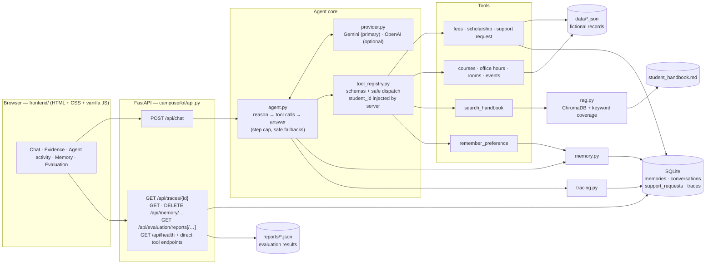

# CampusPilot AI — Intelligent Student Support Agent

Assignment 1 for *Agentic AI Engineering*: **one working agent** that answers student questions by deciding, per question, whether to answer directly, call a tool, retrieve handbook policy, or use remembered information — with a chat dashboard, execution traces and an evaluation.

All data (students, courses, handbook, …) is **fictional**. The project is Python (FastAPI) + vanilla HTML/CSS/JS. There is no LangChain, React or Streamlit.

> **Honest status.** Everything is tested with a scripted stand-in for the LLM and the real local embedding model, and **one real Gemini round trip has now been observed** (`gemini-3.6-flash` called `check_fee_status` and answered from its result: 2578 input / 269 output tokens, 3.4 s). That is a single request, and a first live evaluation attempt was cut short by Google's quota errors (HTTP 429): only 3 of its 13 runs reached the model (a fee question, a scholarship question and a handbook policy question, all answered correctly), so it is **not** a quality measurement (read with the current rules: 3 completed runs, all passed, and 10 runs blocked by quota; three runs say very little).
>
> **Assignment 2 (complete; verified offline).** The API requires sign-in, and the dashboard now has a **sign-in screen**, role-based views (students: chat and their own data; staff: the approval queue and the evaluation reports), a **staff approval workflow** for the sensitive action `update_contact_details` (a student's own email or phone), and a view of the Assignment 2 **security-evaluation report**. See [Sign-in and access control](#sign-in-and-access-control) and [Assignment 2 security evaluation](#assignment-2-security-evaluation-offline). **Not done:** no live LLM evaluation was run for Assignment 2 (everything was verified offline with a scripted model), and the demo accounts have not been seeded into the real database.
>
> Beyond those few requests: real-model accuracy, tool-choice quality on the other scenarios, memory behaviour and the "do not invent policy" instruction are still **unmeasured** — see [Evaluation](#evaluation) for exactly what is and is not known, and [Running a live evaluation](#running-a-live-evaluation) to produce them.

---

## What it demonstrates (Assignment 1 checklist)

| Requirement | Where it lives |
|---|---|
| Agent loop that decides when a tool is needed and uses the result before answering | `campuspilot/agent.py` |
| At least two useful tools (here: 10) | `campuspilot/tools.py`, `campus_tools.py`, `tool_registry.py` |
| Persistent memory across sessions; temporary/sensitive info is not stored | `campuspilot/memory.py` (SQLite) |
| Retrieval from one handbook; only relevant chunks reach the model | `campuspilot/rag.py` (ChromaDB), `data/handbook/student_handbook.md` |
| Context selection: current question + only what is needed | `Agent._build_context` (recent turns of this session, this student's saved preferences, tool/handbook results on demand) |
| Missing information, tool errors, unanswerable questions | tools return `{"error": …}`; handbook returns "not found"; agent has step cap and safe fallbacks |
| Trace per run: tools, evidence, latency, tokens | `campuspilot/tracing.py` → SQLite `traces`, `GET /api/traces/{id}` |
| Accuracy, tool appropriateness, latency, tokens, evidence | `campuspilot/evaluation.py`, `scripts/run_evaluation.py` |
| Chat-style interface | `frontend/` (served at `/`) |
| Sample data / policy document | `data/*.json`, `data/handbook/student_handbook.md` |
| Evaluation table | [below](#evaluation) and `reports/` |

Demo scenarios from the brief and how to try them in the dashboard:

1. *"What is my current fee status?"* — tool call (`check_fee_status`).
2. *"The payment portal failed. Can I pay on the next working day?"* — handbook retrieval (section 2).
3. *"Please call me Dev from now on."* then **New session** and ask something — saved preference is recalled across sessions (Memory tab).
4. A sensitive or temporary statement (e.g. a bank account number, "just for today …") — refused by the memory validator and redacted from stored history.
5. *"Where can I park my car on campus?"* — handbook has nothing relevant → "not found", no invented policy.

---

## Architecture



### One request, step by step

1. The browser sends `{message, student_id, session_id?}` to `POST /api/chat`.
2. `Agent` builds the context: system prompt, **this student's** saved preferences (as data, not instructions), the last few turns of **this session**, and the new question. It never sends the handbook.
3. The LLM either answers or asks for tools. Each call goes through `ToolRegistry.execute`, which validates arguments, injects the student ID from the request (the model cannot choose whose records to read), catches every exception and returns `{"error": …}` instead of failing.
4. Tool results go back to the LLM, repeated up to `max_steps` (4) times, then the final text is returned.
5. The turn is saved (redacted) to conversation history, and a **sanitised trace** is written to SQLite. The response includes latency, tokens (only if the provider reported them), tools called, evidence, memory used/saved and a `trace_id`.

### Modules

| Module | Responsibility |
|---|---|
| `config.py` | Environment/`.env` settings; API keys are hidden from `repr` |
| `db.py` | SQLite schema + guarded migrations |
| `provider.py` | `LLMProvider` interface; `GeminiProvider` (google-genai, manual function calling, thought-signature round-trip) and `OpenAIProvider`; normalised responses with optional token counts |
| `agent.py` | The agent loop, context building, evidence collection |
| `tool_registry.py` | Tool schemas, dispatch, error containment |
| `tools.py`, `campus_tools.py` | Student-record tools; courses, office hours, rooms, events |
| `rag.py` | Handbook chunking, ChromaDB index, hybrid relevance rule |
| `memory.py` | Allow-listed preferences, sensitive-content screening, redacted history |
| `tracing.py` | Sanitised per-run traces |
| `evaluation.py` | Test cases, deterministic scoring, metrics, report rendering |
| `api.py` | FastAPI app: sign-in, protected routes with a startup route-classification check, report endpoints, static dashboard |
| `auth.py` | Password hashing (scrypt), accounts, lockout, login sessions (token hashes only) |
| `authz.py` | `Principal` and the deny-by-default authorization policy (student / staff) |
| `audit.py` | Append-only, hash-chained audit log with integrity verification |
| `approvals.py` | Human approval of sensitive actions: state machine, signed requests, atomic single execution |
| `sensitive_actions.py` | The contact-detail change: validation, masking, the executor and the `student_contacts` overlay table |
| `security_evaluation.py`, `security_report.py` | Assignment 2 offline security evaluation: scenarios, metrics, Assignment 1 vs 2 comparison, report |
| `secrets_guard.py` | One shared detector/redactor for passwords, OTPs, keys, card and id numbers |

### Tools (10)

| Tool | Purpose | Notes |
|---|---|---|
| `check_fee_status` | Fee total/paid/due/status | always the signed-in student's record; an optional `student_id` naming someone else is refused and audited |
| `check_scholarship_status` | Scholarship name/amount/status | same rule |
| `create_support_request` | Opens a ticket (`TKT-…`) in SQLite | validated category + description |
| `search_course_catalog` | Courses by name/ID/keyword, optional department | |
| `get_professor_office_hours` | Office room and weekly hours | partial, case-insensitive name |
| `check_room_availability` | Bookings on a weekday; optional time-window check | 24h `HH:MM`, validated |
| `get_campus_events` | Upcoming events by category/date | |
| `search_handbook` | Relevant handbook excerpts with chunk ids, or `found=false` | never returns the whole handbook |
| `remember_preference` | Saves one lasting, non-sensitive preference | five allowed keys; see below |
| `update_contact_details` | Asks to change the signed-in student's own email or phone | creates a **pending approval** only; nothing changes until staff approve (see Approval of sensitive actions) |

### Handbook retrieval

The handbook is split into section-aware chunks (14 chunks, ids like `student_handbook.md#s2-1`) and indexed in ChromaDB with a **local** embedding model (Chroma's default MiniLM; no API key). A chunk is returned only if the relevance rule accepts it, at most 3 per question. The rule combines **semantic similarity** with **keyword coverage** (how much of the question's information-weighted vocabulary appears in the chunk):

* similarity ≥ 0.50 on its own, or
* ≥ 2 distinctive matched terms, coverage ≥ 0.60 and similarity ≥ 0.10 (rescues exact-term queries the embedding dilutes), or
* ≥ 1 distinctive term, similarity ≥ 0.40 and coverage ≥ 0.18.

If nothing is accepted the tool answers `found=false` with an instruction not to invent a policy, and the agent says the information was not found. Each returned chunk carries its similarity, keyword coverage and the reason it matched. A single global similarity threshold was tried first and failed in both directions (see [Evaluation](#evaluation)).

### Memory and privacy

* Only five keys can be stored across sessions: `preferred_name`, `preferred_language`, `preferred_contact_channel`, `study_preference`, `interested_topic`.
* Values are screened **in code**, not by trusting the model: credentials/OTP/PIN, card/bank/UPI/identity details, long digit runs, email addresses, health terms, money amounts, temporary phrases ("today", "this week") and instruction-like text are rejected.
* **Secrets never reach the model or the database (Assignment 2, Batch 3).** Passwords, OTPs/verification codes, PINs, API keys and tokens, and card, bank-account and national-id numbers are detected by one shared module (`campuspilot/secrets_guard.py`) and masked **in place** (`my OTP is [REDACTED:otp]`) *before* the message is sent to the LLM and before anything is written to conversation history, traces, support-request descriptions or audit details. The rest of the message is kept, so ordinary questions ("How do I reset my password?") are not destroyed. If the assistant has just asked for a code or password, a short bare reply ("73920158") is treated as the secret. The model is told to remind the student never to share such things, and each masking is audited (categories only, never the value). Personal data that is present (an email address, an amount, a health term, a long number) still replaces the whole stored message, as before. Tool outputs are never stored.
* Traces store a *summary* of each tool call (outcome, field names, chunk ids, ticket id), never raw tool outputs; LLM errors are stored as the exception type plus, for recognised API errors only, the HTTP status and a short message with key-like text masked (any other exception: type name only), so keys cannot leak.
* The dashboard keeps its state in memory only (nothing in browser storage) and inserts all dynamic text via `textContent`.

---

## Quick start

**Prerequisites:** Python 3 with `venv` (developed and tested on Python 3.14.2 / macOS; other versions are untested). Optional: Node.js and Google Chrome, only for the browser tests.

```bash
git clone <this repo> && cd CampusPilot-AI
python3 -m venv .venv
.venv/bin/pip install -r requirements.txt
```

**Configure a key** (needed only for `/api/chat`; everything else works without one):

```bash
cp .env.example .env
# edit .env and set GEMINI_API_KEY=...   (or OPENAI_API_KEY=... and LLM_PROVIDER=openai)
```

Never commit `.env` or paste keys into the code — `.env` is git-ignored and the app never prints keys.

**Run:**

```bash
.venv/bin/python main.py
```

Open **http://127.0.0.1:8000/** for the dashboard (interactive API docs at `/docs`).

* **Sign-in (Assignment 2):** create the fictional accounts once with `.venv/bin/python scripts/seed_demo_users.py` (random passwords printed once) or `--demo` (fixed, documented demo passwords `Demo-<id in lower case>-2026`, fictional data only). This only adds rows to the SQLite file. **The demo accounts have not been seeded into the real database** (the script has not been run against it), so until you run it nobody can sign in. Then open the dashboard and sign in: the page shows only a sign-in form until the server accepts a login. Every route except `GET /api/health` and `POST /api/auth/login` requires a valid bearer token, which the dashboard sends for you after sign-in. The token is kept in memory only (never in browser storage), so **reloading the page signs you out**; sessions also end after 60 minutes, on sign-out, or when the server revokes them, and the page then returns to the sign-in screen.
* Students are `STU001`–`STU004` (`data/students.json`) and staff is `STAFF01` (both created by the seed script). A student's id now comes from the server when they sign in; there is no Student ID box any more, and chat requests carry no student id.
* Without a key the page shows a "no LLM key configured" chip and (once signed in) chat replies with the server's own 503 message — no fake answers; the chip itself works because `/api/health` is public. The offline evaluation script (`scripts/run_evaluation.py --offline`) still works without a key or sign-in. The dashboard's Memory, Activity and Evaluation views call protected endpoints (`/api/memory/...`, `/api/traces/...`, `/api/evaluation/reports`), which need a bearer token; the dashboard sends it once you are signed in.
* The first handbook search (or `scripts/ingest_handbook.py`) downloads Chroma's default local embedding model (~80 MB) once to `~/.cache/chroma/`, so it needs internet that first time.
* To pre-build the handbook index: `.venv/bin/python scripts/ingest_handbook.py` (add `--force` to rebuild).

### Dashboard

Students see the chat and all five inspector tabs. **Staff see no chat**: only the Approvals and Evaluation tabs. Which tabs and buttons appear is a convenience; the server decides what each user may do, so a student who called an approve endpoint directly would still get HTTP 403.

| Tab / area | Shows |
|---|---|
| **Conversation** | Chat with tool badges, latency, tokens (only if reported), memory used/saved, retry on errors. Assistant replies are rendered as **safe Markdown** (bold, lists, code, links); your own messages stay literal text |
| **Evidence** | The handbook chunks the agent was given for the selected turn (id, similarity, keyword coverage, match reason, exact excerpt) or "nothing relevant found" — taken only from the real API response |
| **Agent activity** | The stored trace for the selected turn: action, status, latency, tokens, provider/model, each tool step and its outcome |
| **Memory** | The student's saved preferences; delete with confirmation |
| **Approvals** | *Student:* the contact details on file (changed only by an approved request), their own requests with status (pending, approved and applied, rejected, withdrawn, expired, failed) and a Withdraw button for a pending one; *staff:* the pending queue with the proposed value **masked**, an optional reason, and Approve / Reject (each needs a confirming second click). The page shows the server's answer, including refusals such as "this request can no longer be changed" |
| **Evaluation** | Real saved reports, clearly labelled **OFFLINE** (pipeline check) or **LIVE** (real model). The tab only *displays* report files; it never runs an evaluation, and it says so when no LIVE report exists. The server checks that each report's label matches who produced its runs (an OFFLINE report must be all scripted, a LIVE one must contain none); a mismatch is shown as a red **INCONSISTENT** warning and counted as "unverified", never as live. **Assignment 2 security reports** (`assignment2_evaluation_*.json`) are listed as ASSIGNMENT 2 SECURITY · OFFLINE and shown with their metrics (numerator/denominator, target, status), per-scenario checks with trace and audit evidence (opened on demand), the Assignment 1 vs Assignment 2 comparison and the limitations |

### API

| Endpoint | Access | Purpose |
|---|---|---|
| `GET /api/health` | public | Status and whether an LLM provider is configured |
| `POST /api/auth/login` | public | `{user_id, password}` → bearer token (401 for any failure, same answer each time) |
| `GET /api/auth/me` · `POST /api/auth/logout` | signed in | Current user / end this session (the token stops working immediately) |
| `POST /api/chat` | signed in | `{message, session_id?}` → reply, `session_id`, `trace_id`, tools called, evidence, memory used/saved, latency, tokens, error (a `student_id` in the body is optional and must be your own) |
| `GET /api/traces/{trace_id}` | signed in, owner only | One sanitised execution trace (someone else's looks like "not found") |
| `GET /api/memory/{student_id}` · `DELETE /api/memory/{student_id}/{key}` | signed-in student, own id only | View / delete saved preferences |
| `GET /api/students/{id}/fees` · `…/scholarship` · `POST /api/support-requests` | signed-in student, own id only | Direct tool endpoints (no LLM) |
| `GET /api/evaluation/reports` · `GET /api/evaluation/reports/{name}` | signed in | Saved evaluation reports: Assignment 1 reports (`evaluation_offline_*` / `evaluation_live_*`) and Assignment 2 security reports (`assignment2_evaluation_*`, listed with `kind: "assignment2_security"`). The server computes each report's `integrity` and ignores any other file name |
| `GET /api/students/{id}/contact` | signed-in student, own id only | Contact details as last changed by an approved request (empty until one is approved) |
| `GET /api/approvals` · `GET /api/approvals/{id}` | student: own requests; staff: the pending queue | Requests with status; staff see the proposed value masked (`d***@example.edu`, `********6789`) |
| `POST /api/approvals/{id}/approve` · `…/reject` | **staff only** | `{reason?}`; approve also runs the change, once |
| `POST /api/approvals/{id}/cancel` | the requesting student | Withdraw a pending request |

There is deliberately **no** endpoint to list all traces, students or conversations.

### Sign-in and access control

*(Assignment 2, Batches 1–6.)*

* **Identity:** `POST /api/auth/login` checks a salted scrypt password hash and returns a random bearer token; only the token's SHA-256 is stored. Sessions expire (default 60 min) and logout revokes them on the server. Five wrong passwords lock the account for 15 minutes.
* **Who you are comes only from the token.** A student id in a URL, a request body or a model's tool arguments is compared with the signed-in user and refused (HTTP 403, or a refusal message to the model) if it names someone else. The refusal is the same whether or not that student exists.
* **Roles:** `student` (own records only) and `staff` (public information, the evaluation reports, and approving or rejecting sensitive changes). Staff cannot read students' private fee, scholarship or contact data, and see proposed contact values only masked.
* **Enforced in code:** every route is classified `public` or `protected` in `campuspilot/api.py` and the app refuses to start if one is unclassified or unguarded; every tool checks the principal in `campuspilot/tool_registry.py`. The LLM prompt is not a security control.
* **Audit:** refusals, sign-ins, private reads and writes are recorded in an append-only, hash-chained audit log before data is returned or a change is made; if the record cannot be written the request fails (HTTP 503). Passwords, tokens and secrets are never written to it.
* **Approval of sensitive actions (Batch 4):** the sensitive action is `update_contact_details` (a student's own email or phone). The tool, or any caller, only creates a **pending** request; the data is not changed. A separate staff account approves or rejects it. States: `pending` → `approved` → `executed` (or `failed`); `pending` → `rejected` / `cancelled` / `expired` are terminal and **never execute**.
  * Who: only `staff` may decide; the requester can never decide their own request (checked in `authz.py` and again at execution). Students see only their own requests; someone else's request looks like a missing one.
  * Expiry policy: a request is valid for 24 hours from creation (`approval_ttl_minutes`); an expired request, including one approved but not yet executed, is never executed.
  * Single execution: the decision is a conditional database update, and the change plus the `executed` status happen in one transaction, so two approvals or two threads cannot run it twice.
  * Tamper evidence: the stored request (student, requester, field, value, times) carries an HMAC-SHA256 signature, and the approval adds a second one over the approver and time; both are verified before the decision and again inside the execution transaction. The key is a random 32-byte file `.approval_key` (mode 0600, git-ignored) beside the database, not in it.
  * At execution the approver and requester accounts are looked up again and re-authorized.
  * Audit: the request, the decision and the start of execution are recorded **before** the change runs (if a record cannot be written, nothing runs: HTTP 503), then the result. Audit records, traces and staff views never contain the proposed value.
  * Limits: someone who can read both the database file and the key file can forge a request; the proposed value sits in clear text in the `approvals` table until the request ends (the executor needs it); approved changes are stored in the new `student_contacts` table, not in `data/students.json`, which has no contact fields; the approval screens (Batch 6) only display the server's answers.
* **Dashboard (Batch 6):** sign-in, sign-out, session-expiry handling, role-based views and the approval screens are in the page (`frontend/js/auth.js`, `approvals.js`, `security.js`). The password is read once, the field is emptied immediately and it is sent only to `POST /api/auth/login`; the token lives in a module variable in `api.js` (not in the store, the DOM, browser storage or any message), signing out or a 401 wipes the conversation, traces, memory, requests and reports from the page, and every dynamic string is inserted as text (no `innerHTML`). A student never sees Approve or Reject, but that is only presentation: the server refuses any such call.
* **Frontend limits (stated):** reloading signs you out (by design: nothing is stored); the app sets no Content-Security-Policy or other security headers; it is meant for `127.0.0.1` over plain HTTP, not for the internet; there is no password reset, no multi-factor step and no per-IP rate limit; the page cannot tell a locked account from a wrong password (the server answers identically).
* **Secret handling limits:** detection is pattern-based, so an unusual wording, another language or a number spelled out in words can slip through, and a bare number with no preceding request for a code is just a number. Rows stored by Assignment 1 are not rewritten.

### Configuration

| Variable | Default | Meaning |
|---|---|---|
| `LLM_PROVIDER` | auto | `gemini` or `openai`; empty = Gemini if its key is set, else OpenAI |
| `GEMINI_API_KEY` / `OPENAI_API_KEY` | — | Provider keys (only the one you use) |
| `GEMINI_MODEL` / `OPENAI_MODEL` | `gemini-3.6-flash` / `gpt-4o-mini` | Model availability changes over time: with the author's key `gemini-3.6-flash` worked, `gemini-2.5-flash` returned HTTP 404 and `gemini-3.7/3.8-flash` returned 503 "high demand" on the day of testing. `gpt-4o-mini` is unverified |
| `DATABASE_PATH` | `data/campuspilot.sqlite3` | SQLite file |
| `HANDBOOK_MIN_SCORE` / `HANDBOOK_STRONG_SCORE` | `0.40` / `0.50` | Retrieval thresholds (see above) |

---

## Evaluation

`scripts/run_evaluation.py` runs 12 fictional cases (13 agent turns): fee status, scholarship, two handbook-policy questions, two missing-evidence questions, an unknown-student tool error, memory recall across two sessions, sensitive info not stored, a direct answer, a support request and office hours. Scoring is **rule-based** (tool choice must include the expected tools and nothing outside the allowed set; checks on tool results, retrieved evidence and answer keywords) — there is no LLM judge, and keyword checks can misjudge unusual but correct wording. Each run uses a throw-away database, and a report is written to `reports/` as Markdown and JSON.

### Latest results — **OFFLINE** mode (`reports/evaluation_offline_20261022_000402.md`)

> Offline mode replaces the LLM with a script, so these numbers show that **tools, handbook retrieval, memory and tracing work end to end** — they say **nothing** about how well a real model chooses tools or words answers. Latency excludes any LLM/API time, and no tokens are reported because nothing was called.

| Measure | Result |
|---|---|
| Cases fully passed | 12 / 12 |
| Runs passed | 13 / 13 |
| Tool choice appropriate | 13 / 13 |
| Traces recorded in SQLite | 13 / 13 |
| Handbook answers citing a chunk id | 2 / 2 |
| Tool errors observed | 1 (the intended unknown-student case) |
| Latency, local pipeline only | min 0 · median 1 · mean 71 · max 654 ms (the max includes loading the embedding model on the first handbook query) |
| Token usage | not available (0 / 13 runs reported usage) |

Note that an earlier offline run scored 11/12: one failure was retrieval returning evidence for an out-of-scope question, and after that was fixed a second failure turned out to be the evaluator's own "not found" wording check, which was then corrected. So part of the 11→12 change is evaluator fixing, not only retrieval.

### Running a live evaluation

```bash
.venv/bin/python scripts/run_evaluation.py --offline  # scripted LLM, no API calls (safe)
.venv/bin/python scripts/run_evaluation.py --live     # real model; needs a key in .env; spends API tokens
```

> **Careful:** running the script with **no flag** uses the real model whenever an API key is configured (it only falls back to an explanation when no key exists). Use `--offline` if you want no API calls.

What a live run does (from the script and test cases):

| | |
|---|---|
| Cases / turns | 12 fictional cases, 13 agent turns (the memory case has two turns in two sessions) |
| API calls | About **24 model calls** if the model behaves like the script (2 per tool turn: choose the tool, then write the answer; 1 for the two direct turns). Hard upper bound **52** (4 steps × 13 turns). Requests are paced (see below); a call that gets HTTP 429 is retried up to 3 times and a 408/5xx up to 2 times, but rejected attempts return no tokens. If Google keeps refusing, the run stops after 2 consecutive blocked turns (about 8 requests over roughly 2½ minutes) instead of working through all 13 |
| Tokens (estimate) | Each call carries about 1.2k tokens of fixed prompt (system prompt + 9 tool schemas) plus the conversation: roughly **30–40k input and 3–7k output tokens in total** (thinking tokens count as output). One measured real turn used 2,578 input / 269 output tokens for 2 calls. This is an estimate, not a measurement |
| Cost | Depends on your plan and the model's current price, which this project does not know; multiply the token estimate by your rates (the free tier may cover it) |
| Time | About 2½–3 minutes with the default pacing (≈24 requests, at least 6 s apart); longer if Google returns 429/503 |
| Files written | `reports/evaluation_live_<timestamp>.md` and `.json` (the JSON contains the model's replies to the fictional test questions). Nothing else |
| Database | Uses a throw-away temporary SQLite database; your real `data/campuspilot.sqlite3` (memory, history, traces, tickets) is **not** modified. It reads the handbook index in `data/chroma/` and does not change `.env` |

**Pacing, quota handling and honest reporting.** A first live run showed that Google's quota can start rejecting requests (HTTP 429) part-way through. Live runs are therefore paced and quota-aware (offline runs ignore all of this and never touch a provider or the network):

| Option | Default | Meaning |
|---|---|---|
| `--min-interval SEC` | 6 | At least this long between the start of two model requests, retries included (6 s = at most 10 per minute; 0 disables) |
| `--quota-retries N` / `--quota-base-delay SEC` | 3 / 10 | Waits after an HTTP 429 double each time: 10, 20, 40 s. The server's own retry hint (Retry-After header, `retryDelay`, "please retry in 34s") is honoured and never undercut |
| `--max-wait SEC` | 90 | Longest single wait. If the server asks for longer (for example a daily quota: "retry in hours") the run does **not** wait it out |
| `--stop-after N` | 2 | After N consecutive provider-blocked turns the remaining turns are **skipped** rather than hammering a provider that is refusing us |

In the report, every run ends as **completed** (it reached the model and finished: PASS or genuinely FAIL), **blocked by provider** (HTTP 429 quota, 408/5xx outage, connection error, or 401/403/404 key/permission/model problem) or **skipped** (not run). Success rates, tool-choice rates, latency and token statistics use **only completed runs**; blocked and skipped runs are listed separately and are never counted as agent failures. Errors that may be the project's own fault (HTTP 400, unexpected exceptions, `max_steps_exceeded`) still count as agent failures. If no run completed, the report says the evaluation measured nothing about the agent. The dashboard shows the same split (banner, "Runs completed", "Blocked or not run", BLOCKED/SKIPPED badges). Reports saved before this change are read with the same rules at display time (the saved file is never rewritten).

Exit codes: **0** every run passed · **1** a completed run failed · **2** no provider configured · **3** inconclusive (the provider blocked some runs and none of the completed ones failed).

Without a configured key the script refuses to run live and exits with an explanation instead of faking results. Live reports are labelled LIVE in the dashboard and include real latency (end-to-end, including the API) and provider-reported token usage. It is one run per case on a non-deterministic model, so treat rates as indicative, and read any failure before trusting it: the checks are keyword-based and can reject a correct answer worded differently.

### Assignment 2 security evaluation (OFFLINE)

`scripts/run_security_evaluation.py` checks that the Assignment 2 controls hold when something tries to get around them. It runs **39 scenarios** (ownership 5, cross-student isolation 9, sensitive-action approval 12, secret handling 13), each in its own temporary database with fictional users, the real app code (real sign-in, authorization, approval and audit) and a **scripted** model. It has no live mode: it never calls an LLM, reads `.env` or touches the real database, so it shows that the *code* refuses, masks, expires and records whatever a model says, not how a real model behaves.

```bash
.venv/bin/python scripts/run_security_evaluation.py                          # report -> reports/assignment2_evaluation_<time>.md/.json
.venv/bin/python scripts/run_security_evaluation.py --skip-assignment1-cases # skip re-running the 12 Assignment 1 cases (they load the local embedding model)
```

Metrics, each reported with its numerator and denominator: task success; unauthorized-access violations; unsafe-action executions; approval correctness; secret leakage (planted secret x location pairs); audit coverage; trace coverage; audit hash-chain integrity; latency; token usage (*not available* offline: never estimated). Latest run (2026-10-30, `reports/assignment2_evaluation_20261030_092530.md`): 39/39 scenarios passed, task success 21/21, **0/64** unauthorized-access violations, **0/22** unsafe-action executions, approval correctness 19/19, **0/108** secret-leakage pairs, audit coverage 28/28, trace coverage 58/58.

The report also compares Assignment 1 and Assignment 2 and marks each row comparable, partly comparable or not. Only the 12 original cases are directly comparable (13/13 runs and 12/12 cases both times); Assignment 1 has no measurement of ownership, approval or audit because those controls did not exist, and there is no Assignment 2 live evaluation, so no such numbers are invented. Limits: scripted model only, a self-written finite probe set, pattern-based secret detection, threads in one process, backend only. The new reports use the `assignment2_evaluation_` prefix; the dashboard's Evaluation tab lists them separately from the Assignment 1 reports (labelled ASSIGNMENT 2 SECURITY · OFFLINE) and renders them in their own view.

### Retrieval quality (real embedding model; `scripts/evaluate_retrieval.py`)

The evaluation exposed a retrieval weakness (a query about "student visa extension" — a topic the handbook never mentions — returned a chunk because of the generic word "student", while a literal "re-evaluation of answer script" query scored too low). The relevance rule was changed from a single similarity threshold to the hybrid rule above. Labelled queries (in-scope answered / out-of-scope rejected), before → after:

| Query set | In-scope answered | Out-of-scope rejected | Provenance |
|---|---|---|---|
| design (32 + 25) | 27 → **32** / 32 | 22 → **25** / 25 | looked at while designing: **in-sample** |
| held-out 1 (12 + 12) | 10 → 10 / 12 | 10 → 11 / 12 | informed one tuning step |
| held-out 2 (14 + 13) | 13 → 13 / 14 | 10 → 10 / 13 | informed one tuning step |
| held-out 3 (12 + 12) | 11 → 11 / 12 | 10 → 10 / 12 | informed one tuning step |
| held-out 4 (12 + 12) | 10 → 10 / 12 | 7 → 7 / 12 | scored once after the rules were frozen |

Honest reading: the change removes the reported failure class and caused no measured loss, but on genuinely unseen queries it is **no better** than the old rule (held-out 4). Adjacent-topic questions — where the handbook covers the topic but not the fact asked ("Is smoking allowed in the hostel?") — still return chunks; preventing a wrong answer then depends on the LLM obeying the prompt ("answer only from the excerpts"), which is unverified with a live model. Three strict `xfail` tests document this.

---

## Troubleshooting LLM errors

When a reply fails, the chat shows a generic apology and an **agent error** badge; the same detail is stored in the trace and logged on the server as a warning (always key-masked).

| Error text | Meaning | What to do |
|---|---|---|
| `ClientError 404 NOT_FOUND: … no longer available to new users` | The configured model is closed to new keys | Set `GEMINI_MODEL` in `.env` to a current model (Google's message names one) and restart |
| `ClientError 400/401/403 …` | Bad key, key not allowed for this API, or a malformed request | Check the key in Google AI Studio; make sure it is in `.env` (not `.env.example`) |
| `ServerError 503 UNAVAILABLE: … high demand` / `429 RESOURCE_EXHAUSTED` | Temporary overload or rate limit | The app already retries these twice (after 1 s and 2 s); if it still fails, try again later or another model |

Transient failures (HTTP 408/429/500/502/503/504 and connection errors) are retried automatically; 4xx client errors are not, because retrying cannot fix them.

## Tests

```bash
.venv/bin/python -m pytest -q                      # backend, retrieval, evaluation, static audits, browser tests
node --test tests/frontend/*.test.mjs              # pure frontend modules (built-in Node runner, nothing to install)
```

Final verification, freshly run offline on 2026-10-30 (Python run twice, identical): **1047 passed, 0 failed, 1 skipped, 3 xfailed**; **80 Node tests passed**, 0 failed, 0 skipped; `pytest --collect-only` lists 1051 tests. Of the 1047, 423 are the Assignment 1 suite as it was, 191 are foundation tests (Batch 1), 114 enforcement (Batch 2), 175 secret protection (Batch 3), 99 approval and contact update (Batch 4), 25 security evaluation (Batch 5) and 20 for the dashboard integration (Batch 6: 19 report-API tests and 1 browser test); a few Assignment 1 tests were updated because the API now needs sign-in and the dashboard has a sign-in screen (none deleted). The browser tests (headless Chrome, included in the Python run) executed **146 + 92 + 15 = 253** checks, all passing: `ui_smoke.mjs` 146 (the Assignment 1 dashboard features, now behind sign-in), `ui_auth.mjs` 92 (sign-in errors, token handling, student and staff approval flows, session expiry, the security report, phone layouts), `ui_no_key.mjs` 15 (real backend with no LLM key). The skip is the opt-in live Gemini test (`tests/test_live_gemini.py`; it makes real API requests, so it runs only with `RUN_LIVE_TESTS=1` **and** a key); the 3 xfails are the documented retrieval limitation. The suite takes about 2 minutes. No test can make a live API call.

---

## Project structure

```
CampusPilot-AI/
├── main.py                    # uvicorn entry point (dashboard + API)
├── requirements.txt  .env.example  .gitignore
├── AGENTS.md  CLAUDE.md       # rules for AI coding assistants (CLAUDE.md only points to AGENTS.md)
├── PROJECT_STATE.md           # detailed build log: decisions, verified results, limitations
├── campuspilot/               # agent, tools, retrieval, memory, tracing, evaluation, API, auth, authz, audit, approvals, sensitive_actions, secrets_guard, security_evaluation, security_report
├── frontend/
│   ├── index.html
│   ├── css/  base.css · layout.css · components.css
│   └── js/   api · format · dom · markdown · state · auth · chat · evidence · activity · memory · approvals · approvalLogic · evaluation · security · securityLogic · app
├── data/
│   ├── students.json courses.json professors.json rooms.json events.json    # fictional
│   ├── handbook/student_handbook.md                                          # fictional policy document
│   ├── retrieval_queries.json                                                # labelled retrieval test queries
│   └── (campuspilot.sqlite3, chroma/ — generated, git-ignored)
├── scripts/  ingest_handbook.py · run_evaluation.py · run_security_evaluation.py · evaluate_retrieval.py · seed_demo_users.py
├── reports/                   # saved evaluation reports (.md + .json)
└── tests/                     # pytest suite, tests/frontend (Node), tests/e2e (browser: demo_server.py, cdp.mjs, ui_smoke/ui_auth/ui_no_key.mjs)
```

`PROJECT_STATE.md` records every phase, the exact verification performed, and what remains unverified.

---

## Limitations

* **Live-model evidence is still very limited.** Only one real Gemini round trip and 3 completed live evaluation runs exist (fee, scholarship and handbook-policy questions, all passed); the other 10 runs of that evaluation were blocked by Google's HTTP 429 quota errors, so they say nothing about the agent. Three runs are not enough to claim broad accuracy, latency or token-usage validation, and how a real model follows the "do not invent policy" instruction, uses memory and handles the other scenarios is unmeasured. `gemini-3.6-flash` is the only model verified to generate with the author's key; `gpt-4o-mini` is unverified.
* **Authentication exists (Assignment 2) but is a demo-grade design:** accounts are fictional and seeded locally, there is no password reset, no multi-factor step and no per-IP rate limit (only a per-account lockout), tokens live in the SQLite file, and the server is meant for `127.0.0.1`. The dashboard has no sign-in screen yet. Do not expose this server publicly.
* **Rule-based safety screening is not exhaustive.** Unusual phrasings of sensitive data can slip through, and harmless text can be redacted (assistant replies containing money amounts are stored as the redaction placeholder, which weakens follow-up context after fee answers).
* **Retrieval:** adjacent-topic questions and vocabulary-mismatch paraphrases ("complaint" vs "grievance") are not handled by the scores alone (see above).
* **Markdown in replies** is a deliberately small, safe subset (bold/italic, lists, headings, code, quotes, links to http/https/mailto). Tables are shown as monospaced text, images are never loaded, and raw HTML is shown as literal text.
* **Frontend** was tested in Chrome only and not with a real screen reader. It shows only the current page session's messages (a reload starts a new session; server-side history is kept per student and session).
* Memory and history have no expiry; event dates in the sample data are fixed (Oct–Dec 2026), so "upcoming" events will eventually all be in the past.
* Developed and tested on one machine (macOS, Python 3.14.2).
